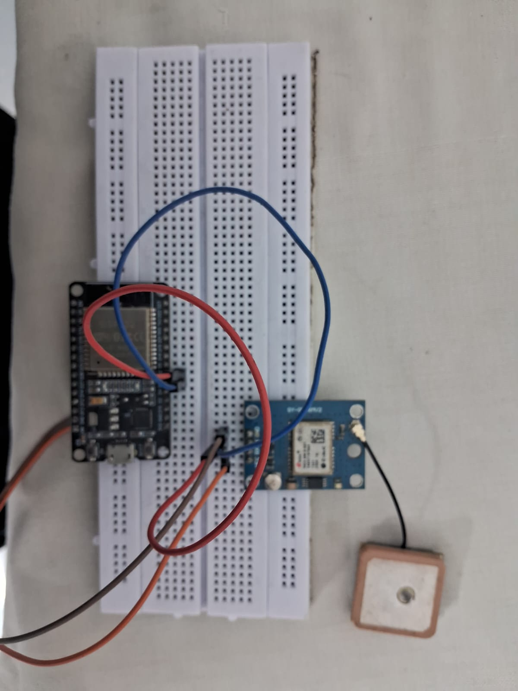
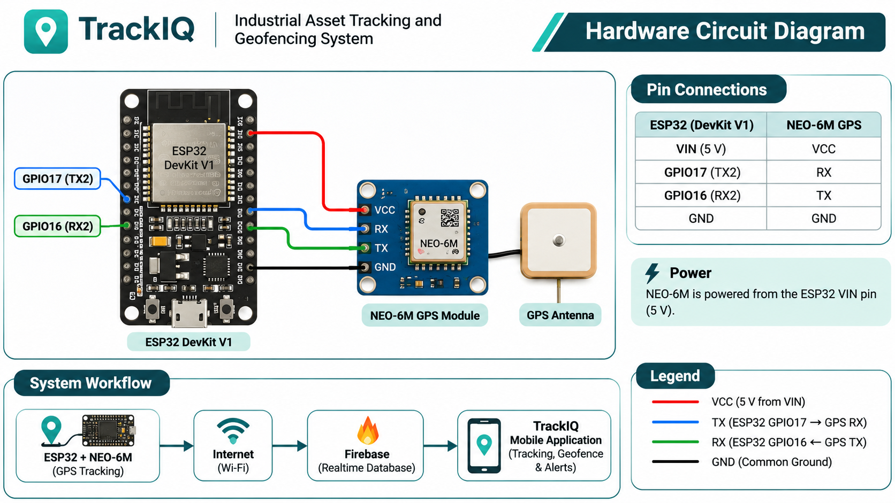
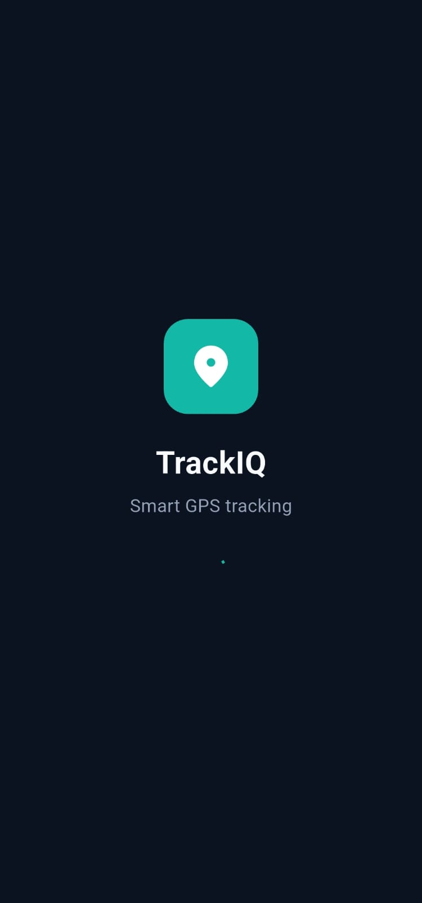
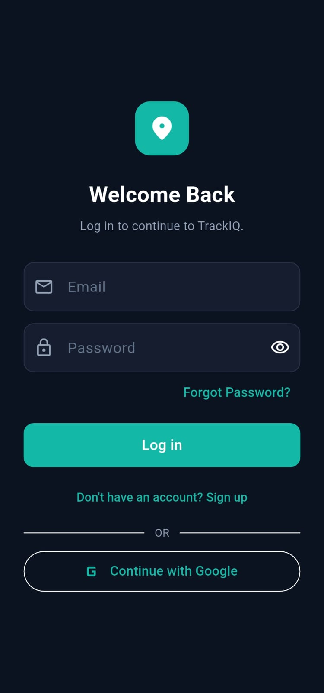
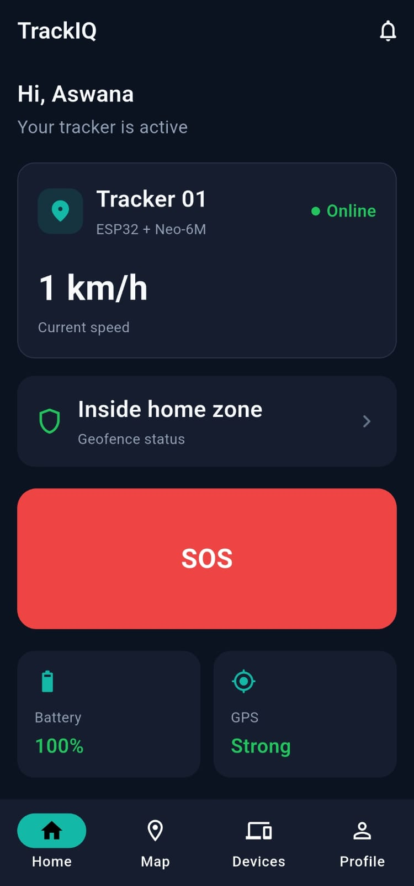
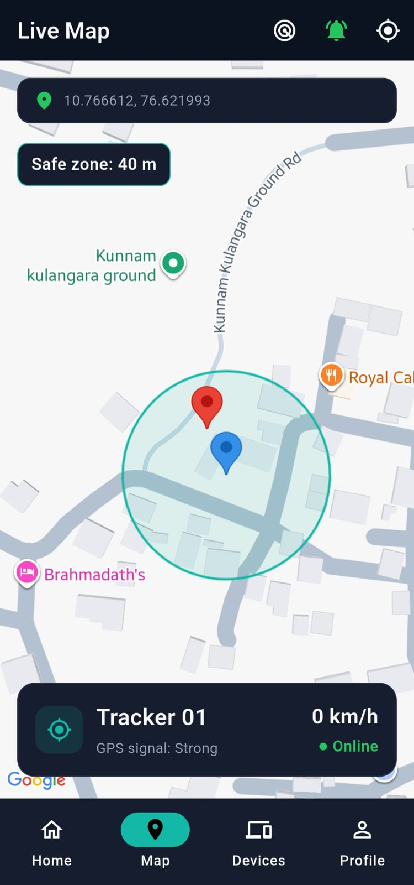
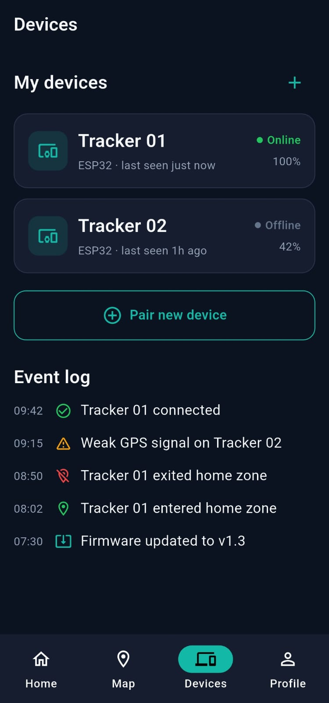
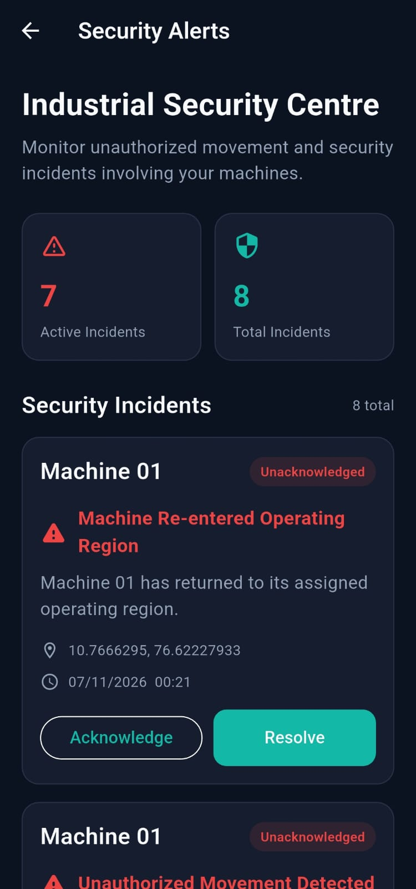
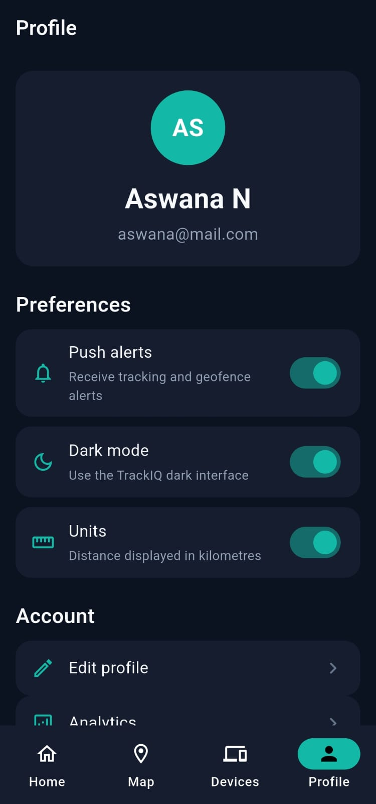

# 🚀 TrackIQ – Industrial Asset Tracking and Geofencing System

**An IoT-based industrial asset monitoring solution integrating GPS tracking, geofencing, cloud connectivity and real-time security alerts.**

TrackIQ is an IoT-powered industrial asset tracking prototype designed to monitor movable industrial equipment and detect unauthorized movement beyond predefined operating regions.

The system integrates an ESP32 microcontroller with a NEO-6M GPS module to acquire location data and transmit it to Firebase. A Flutter-based mobile application provides real-time tracking, geofence configuration, movement notifications and security incident management.

---

## 📌 Project Overview

Industrial equipment and movable assets require continuous monitoring to improve asset visibility and prevent unauthorized relocation.

TrackIQ addresses this challenge through GPS-based tracking and customizable geofencing. It allows users to monitor equipment locations, identify geofence violations and maintain a record of security incidents.

**Project Status:** Functional Prototype

## ✨ Key Features

- 📍 **Real-Time GPS Tracking** – Tracks asset location using ESP32 and NEO-6M GPS.
- 🗺️ **Live Map Visualization** – Displays the current asset location using Google Maps.
- 📌 **Custom Geofencing** – Defines permitted operating regions for industrial assets.
- 🚨 **Unauthorized Movement Detection** – Detects when an asset moves outside its assigned geofence.
- 🔄 **Re-entry Detection** – Identifies when an asset returns to its permitted region.
- 🔔 **Background Monitoring** – Monitors geofence transitions using an Android foreground service.
- 📱 **Instant Notifications** – Generates alerts for geofence exit and re-entry events.
- ☁️ **Firebase Integration** – Stores real-time tracker information and security incidents.
- 🛡️ **Security Incident Management** – Supports incident acknowledgement and resolution.
- 📊 **Route History** – Maintains historical GPS location records.
- 🔐 **Authentication** – Supports user registration, login and Google sign-in.

---

## 🔌 Hardware Implementation

### Hardware Components

- ESP32 DevKit V1
- NEO-6M GPS Module
- GPS Antenna
- Breadboard
- Connecting wires
- USB power supply

### Hardware Prototype

The prototype integrates the ESP32 development board with the NEO-6M GPS module for location acquisition and wireless data transmission.



### Circuit Diagram

The following diagram illustrates the ESP32 and NEO-6M GPS module connections.



### ESP32 – NEO-6M Pin Connections

| ESP32 DevKit V1 | NEO-6M GPS |
|---|---|
| VIN (5V) | VCC |
| GPIO17 (TX2) | RX |
| GPIO16 (RX2) | TX |
| GND | GND |

**UART Communication:** The TX and RX connections are crossed to establish serial communication.

*Note: Verify that your specific NEO-6M breakout board supports 5V input at VCC before connecting it to the ESP32 VIN pin.*

---

## 📱 Mobile Application

TrackIQ is developed using Flutter and Dart, with Firebase providing cloud-based data storage and authentication.

### 1. Application Splash Screen and Authentication

The application includes a dedicated splash screen and secure authentication interface with email/password login and Google sign-in.

| Splash Screen | Login Screen |
|---|---|
|  |  |

### 2. Home Dashboard

The dashboard provides an overview of tracker connectivity, current speed, geofence status, battery information and GPS signal strength.



### 3. Live GPS Tracking

The live map displays the tracked asset's current GPS location and its configured geofence.



### 4. Device Management

The Devices screen displays paired trackers, their connectivity status, battery information and event logs.



### 5. Industrial Security Centre

The Security Alerts screen provides an overview of security incidents, including unauthorized movement and safe-zone re-entry events.

Users can acknowledge and resolve recorded incidents.



### 6. User Profile and Preferences

The profile screen provides account information and application preferences, including push alerts, dark mode and distance units.



---

## 🛠️ Technology Stack

| Category | Technologies |
|---|---|
| Microcontroller | ESP32 |
| GPS Module | NEO-6M |
| Mobile Development | Flutter, Dart |
| Cloud Backend | Firebase |
| Database | Firebase Realtime Database |
| Authentication | Firebase Authentication |
| Map Integration | Google Maps |
| Notifications | Flutter Local Notifications |
| Background Monitoring | Flutter Foreground Task |
| Communication | UART, Wi-Fi |

---

## 🚀 Getting Started

### Prerequisites

- Flutter SDK
- Dart SDK
- Android Studio or Visual Studio Code
- Firebase project
- Google Maps API key
- ESP32 development board
- NEO-6M GPS module

### 1. Clone the Repository

```bash
git clone https://github.com/Aswana03/TrackIQ.git
```

### 2. Navigate to the Project Directory

```bash
cd TrackIQ
```

### 3. Install Dependencies

```bash
flutter pub get
```

### 4. Configure Firebase

Configure your own Firebase project and enable:

- Firebase Authentication
- Firebase Realtime Database

Add the required Android Firebase configuration and update the application settings.

### 5. Configure Google Maps

Add your Google Maps API key to the Android application configuration.

### 6. Run the Application

```bash
flutter run
```

---

## 📦 Download APK

**TrackIQ – Android Prototype**

Download the application from GitHub Releases:

👉 [Download TrackIQ APK](ADD_GITHUB_RELEASE_LINK_HERE)

*Note: This is a prototype application distributed outside the Google Play Store.*

---

## 🔮 Future Enhancements

- Multi-user and role-based access management.
- Multi-company asset management.
- Advanced industrial asset analytics and reporting.
- Machine operating-state monitoring through additional sensors.
- Improved GPS reliability and backup positioning.
- Email and SMS alert integration.
- Scalable cloud infrastructure for multiple industrial assets.
- Industrial-grade hardware enclosure and power management.

---

## 🎯 Project Objective

TrackIQ demonstrates the integration of embedded systems, GPS technology, IoT communication, cloud databases and mobile application development to address industrial asset tracking and security challenges.

The current prototype establishes a foundation for future industrial deployment and scalability.

## 👩‍💻 Developer

**Aswana N.**

B.Tech – Electronics and Communication Engineering  
NSS College of Engineering, Palakkad

- GitHub: [Aswana03](https://github.com/Aswana03)
- Project Repository: [TrackIQ](https://github.com/Aswana03/TrackIQ)

---

<p align="center">

### TrackIQ

**Smarter Tracking. Safer Assets.** 🚀

</p>
